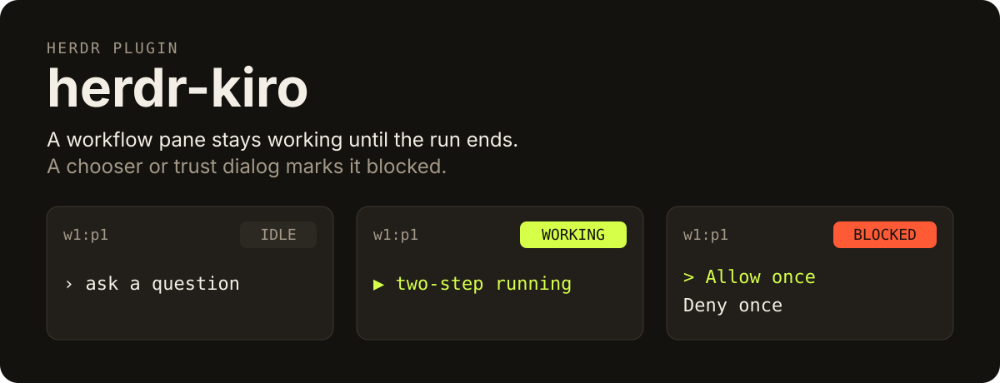
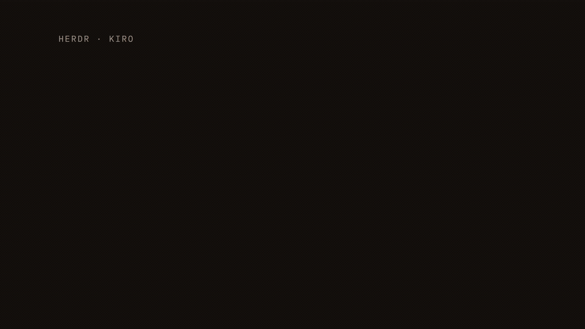

<p align="center">
  
</p>

# herdr-kiro

A [herdr](https://herdr.dev) plugin that reports a [Kiro CLI](https://kiro.dev/docs/cli) V3 session to the Herdr App, and still to the Herdr TUI.

This plugin reports to the App only with OSC 7501 on the program's own output. `hc` is the herdr-core CLI. It can print a screen and paste input. It cannot set status. Inside an App terminal that is not a Herdr TUI pane, core sets `HC_TERMINAL_ID`, and this hook writes one report to that pane's tty:

- a running turn is `state=working:app=kiro-cli`
- a chooser or the workspace-trust dialog is `state=blocked:kind=permission:app=kiro-cli`
- a question panel is `state=blocked:kind=question:app=kiro-cli`
- a finished turn is `state=done:app=kiro-cli`

The hook writes `app=kiro-cli`. A status whose app is `kiro` is still this program.

A stored owner needs a fine `/proc` start time (Linux). On macOS the hook records no owner, so Stop still ends the turn. In an App terminal it still paints OSC 7501 by resolving the live outer `kiro-cli` from the hook's parent chain at paint time and writing that process's stdout tty. That lineage pid is never stored as an owner. A TUI pane does not use that App paint path.

`herdr-app ls` shows `blocked` as needing you. It shows `done` while the turn is unseen, and idle once `herdr.seen` is that turn. The painted Agents section is a separate hold: a focused row that was under Done stays under Done after that list status is idle, and selecting another tab in the same space moves the row to Idle. A finished turn stays `state=done` on the wire.

The Herdr TUI path is unchanged. `HERDR_ENV=1` and `HERDR_PANE_ID` still call `herdr pane report-agent` with `working`, `idle`, or `blocked`. A finished turn is an `idle` report. herdr 0.9.5 shows that unseen idle as done. The hook does not call `release-agent` while `kiro-cli` is running. `report-agent` and `release-agent` run only from a TUI pane, never from an App terminal. A live pid whose token is empty, `sec:` plus a whole-second start, or a bare whole-second start is not an exit and is not a stored owner.

Stock Kiro detection reads the idle prompt and calls the pane idle, including when `▶ name running` is still painted above that prompt. On the TUI, this plugin reports the pane from the workflow and from those dialogs. herdr 0.9.5 does not merge a local detection file with the remote one, so installing this replaces upstream Kiro rules until you uninstall.

## Demo

One pane, twelve seconds. The prompt looks idle, the banner is still a running workflow, then `Allow once` blocks the pane.



The GIF above (960×540, 12 seconds) is [demo/herdr-kiro-demo.gif](demo/herdr-kiro-demo.gif). The source render is [demo/herdr-kiro-demo.mp4](demo/herdr-kiro-demo.mp4) (1920×1080, 30 fps). The three states, in order:

1. The idle prompt and no banner: the pane is idle.
2. `▶ two-step running` is on screen: the pane is working.
3. `Allow once` and `Deny once` are on screen: the pane is blocked, banner or not.

## Install

Requires herdr 0.9.5 or newer, Kiro CLI 3.0 or 3.1 (`kiro-cli` on `PATH`), and Python 3.9 or newer. Platforms in `herdr-plugin.toml` are Linux and macOS.

```bash
herdr plugin install njs14/herdr-kiro-pulse
```

The manifest `build` step runs `install.sh`. It writes the Kiro hook to `~/.kiro/hooks/herdr-kiro.json` and the detection override to `~/.config/herdr/agent-detection/kiro.toml`, backs up any file of yours it would replace, and reloads agent manifests. It uses no sudo and no network. The `startup` hook re-applies it on each herdr start unless you uninstalled.

Manual install from a clone:

```bash
./install.sh
```

With herdr on `PATH` and no server running, that exits 0. Stdout is `Installed` plus the absolute path of each file, then the restart line. The default paths expand from `$HOME`:

```text
Installed /home/you/.kiro/hooks/herdr-kiro.json
Installed /home/you/.config/herdr/agent-detection/kiro.toml
Restart Kiro CLI so it loads the hook. Start it with: kiro-cli chat
```

`/home/you` stands in for the home directory. `$KIRO_HOOKS_DIR` replaces `$HOME/.kiro/hooks`, and `$XDG_CONFIG_HOME` replaces `$HOME/.config`, when those are set. Stderr when nothing is listening: `note: no herdr server is running; reload happens on the next herdr start`. If `herdr` is not on `PATH`, stderr is `herdr is not on PATH, skipped manifest reload` and the script still exits 0. If `HERDR_SESSION` names a session that is not running, the script exits 2.

Register the same script as a plugin action:

```bash
herdr plugin link /path/to/this/repo --enabled
herdr plugin action invoke herdr-kiro.install
```

`plugin link` does not run `install.sh`. The action does. Linking also does not run the manifest `build` command.

Kiro reads hooks when its process starts. After install:

```bash
kiro-cli chat
```

Kiro CLI 3.0 and 3.1 are the supported CLIs. Interactive chat starts on V3. A saved `chat.agentEngine` of `v2` still selects V2. On 3.1 a hook runs under `node` and `bun` below the outer `kiro-cli`, and there is no `kiro-cli-chat`. Where `/proc` start times are absent, as on macOS, the hook cannot tell that outer start time to better than one second, so it records no owner and Stop ends the turn. In an App terminal it still paints OSC through live outer `kiro-cli` lineage at paint time. A pane file saved by an earlier 0.1.0 build can still hold such an owner; the next hook in that pane drops it. If that owner's process is gone, the hook also ends the busy row it held, because that earlier build never cleared a row on Stop; a session that ended under that build then no longer keeps the pane busy. If that pid is still running, or the hook cannot tell, the row stays until a Stop for that session or until you delete the pane file. A `kiro-cli` that kept running across the upgrade needs no restart for this as long as its hook command still points at the upgraded script; if the upgrade put the plugin in a new directory, restart `kiro-cli`. If `kiro-cli` is killed in the middle of a turn that this version recorded on such a host, that session stays busy in the plugin's pane state: a later session in the same pane ends its own turns but does not clear the killed one. Deleting that pane's file in the state directory clears it. `PreCompact` and `PostCompact` are not registered, because Kiro sends no Stop after `/compact` (seen live on Kiro 3.2.0), so a busy mark set there would never clear. If they arrive anyway, the hook returns without reading or writing anything. `chat.enableWorkflows` has to be `true` for the workflow runs. Nothing in this package writes those settings, and nothing restarts a `kiro-cli` that is already running. In an App terminal with no owner process the hook's watcher does not ask the Herdr TUI server about the pane, which does not know App terminal ids, and exits. Outside an App terminal (`HC_TERMINAL_ID`) and outside a TUI pane (`HERDR_ENV=1` and `HERDR_PANE_ID`) the hook exits without reporting.

```bash
./doctor.sh
./uninstall.sh
```

`./doctor.sh` prints versions and whether the installed files still match the hashes this package wrote. It does not unlink the plugin, and it does not delete the hook or `kiro.toml`. It does remove a watcher pid file whose process is gone. `./uninstall.sh` removes the hook and `kiro.toml` only when this package still owns them, puts a saved `.original` back with the mode your file had before install, and writes `uninstalled` in the lifecycle file. It leaves the state directory (`$XDG_STATE_HOME/herdr-kiro`, by default `~/.local/state/herdr-kiro`) and the lifecycle file in it on purpose: the lifecycle file is how `startup.sh` knows not to install again. If the server is down it appends `pending_unlink=herdr-kiro`. The next `startup.sh` clears that line once `herdr plugin list` succeeds and the plugin is gone.

Rebuild the demo with Node.js 22, FFmpeg, and the `hyperframes` package pinned in `package.json`:

```bash
npm install
cd demo
npx hyperframes check
npx hyperframes render -o herdr-kiro-demo.mp4
ffmpeg -y -i herdr-kiro-demo.mp4 -vf "fps=12,scale=960:-1:flags=lanczos,split[s0][s1];[s0]palettegen=stats_mode=diff[p];[s1][p]paletteuse" -loop 0 herdr-kiro-demo.gif
```

## Why not the stock Kiro rules

The stock idle rule matches `› ask a question or describe a task` on the bottom lines. A workflow leaves that prompt under the banner, so herdr shows idle for the rest of the run.

`prototype/kiro-detection.toml` is herdr's Kiro manifest `2026.09.19.1` plus rules that sit above that prompt:

- A line that starts with `▶`, then a name, then `running`, and contains `ctrl+x`, is working. `ctrl+g` may be on the next line.
- `Allow once` / `Deny once`, the subagent widget, and `Trust this workspace?` are blocked, and they beat the banner.
- The hook calls `release-agent` only when the proven outer `kiro-cli` process has exited. A gone `kiro-cli-chat` is not an exit and does not call `release-agent`, whether or not a replacement is under the outer process. An agent that is gone, and an empty owner table, are not that exit. A live pid with an empty token, `sec:` plus a whole-second start, a bare whole-second start, or a fine token that no longer matches is not an exit and is not painted. A weak exit does not call `release-agent`. A hook first drops a saved owner whose stored start is empty or `sec:`, as a 0.1.0 pane file on macOS has, so that Stop ends the slot. An owner whose stored fine token no longer matches its pid is still weak, and a later Stop leaves that row. A none result does not drop a recorded owner, and it does not assign phase, busy, or a tty. A weak owner gets none and the row stays when the count is not above 1. Count above 1 is touch_partial. Count zero is refresh for a proven owner and none otherwise, and that Stop does not paint done. Blocked is painted only when the table returns paint_blocked for a proven owner, and only commit_pane emits that OSC. `Stop` and `SessionEnd` end a turn or a session. When a proven exit is already owed and the aggregate count is 1, both are `process_exit`. They are not process exit at count zero. A proven owner still chooses `state=done` on that pane, including when the chat child is piped. The held tty is written only when its pid is that owner. An unconfirmed held pid writes nothing for every stored phase, including proven, idle_clear, weak, and exited. That includes touch_aggregate, record_aggregate, refresh, touch_partial, blocked, and a working paint, and does not open the live stdout. There is no pane file, aggregate, busy, grace_until, generation, seq, seq floor, log, watcher, watcher_at, watcher_started, or watcher pid file. A screen read does not delete a pid file. A failed App read is none: it is not explained, it is not a prompt, a banner, a start, or aggregate_zero, and it is not painted from that missing screen. A held banner or blocker is not painted from a screen that was not returned. reap is the runtime deletion, and only for a confirmed dead pid or a confirmed token mismatch. A live pid whose token matches is not reaped when only the comm name differs. A none result, including fault and refuse_watch, returns before any I/O and unlinks nothing. The watch result runs the watcher and is not none. Watcher exit unlinks a pid file only through commit_pane applying reap. Uninstall removes a pid file when the process is absent from the snapshot, and removes one after a signal only when the uid, a fractional `fine_start` token, and the comm basename match. A live `sec:` token, a bare whole-second start, a token or comm mismatch, a snapshot error, or a different uid is left in place. The `pids` directory is left in place. A TUI pane inside the App gets no OSC.

Stay on the stock file if you want herdr to keep applying newer remote Kiro rules. Switch to this if the idle pane during a workflow is the failure you are fixing. The rule-by-rule list is [docs/kiro-detection-diff.md](docs/kiro-detection-diff.md).

## Status

Version 0.1.0, from `herdr-plugin.toml`. Kiro CLI 3.0 and 3.1 are the supported CLIs.

The unit command is `python3 -m unittest tests.test_grace tests.test_install tests.test_detection tests.test_doctor tests.test_redaction tests.test_osc tests.test_state_guard`. `tests.test_osc` writes OSC 7501 to a pty and reads the bytes back, and it keeps a finished turn at `state=done`. It does not launch the Herdr App. `tests/run_py39.sh` is the 3.9 run. CI also runs `uvx ruff check`, `uvx ruff format --check`, `uvx ty check`, and the `drive.py` stand-in recipes under `.cursor/skills/verify-herdr-kiro/features/`. The rule set is in `pyproject.toml`. Live notes are in [VERIFY.md](VERIFY.md). A live App check is a Kiro session inside an App terminal, and it is not this suite. Release notes are in [CHANGELOG.md](CHANGELOG.md) and [docs/RELEASE-0.1.0.md](docs/RELEASE-0.1.0.md).

`python3 harness/run_suite.py` drives workflows in a herdr pane. It needs a session, a Kiro pane, and `KIRO_API_KEY` in that environment. Do not print the key.

## Licence

[Do What the Fuck You Want to Public License, version 2](LICENSE). Copyright (C) 2026 njs14.

Upstream herdr is Apache-2.0. This package does not copy herdr source. The detection file is a local override of the published `kiro.toml` for version `2026.09.19.1`.
